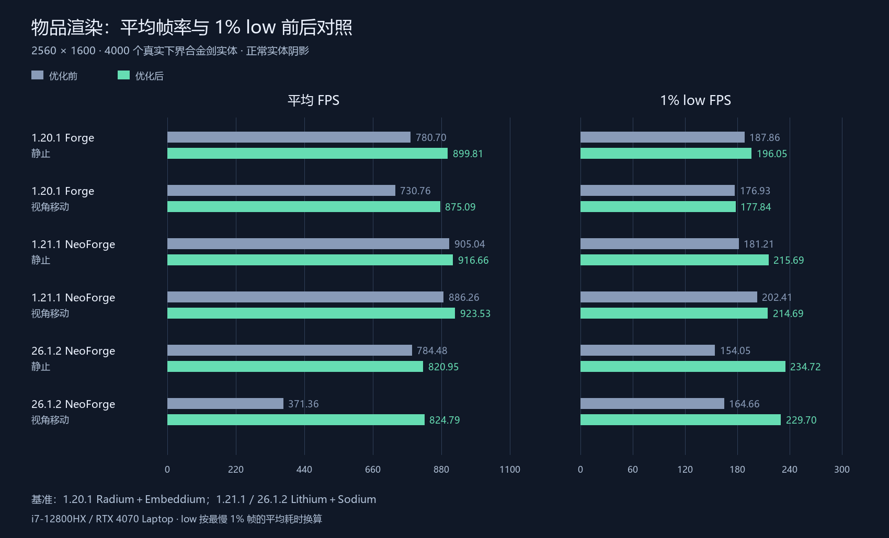
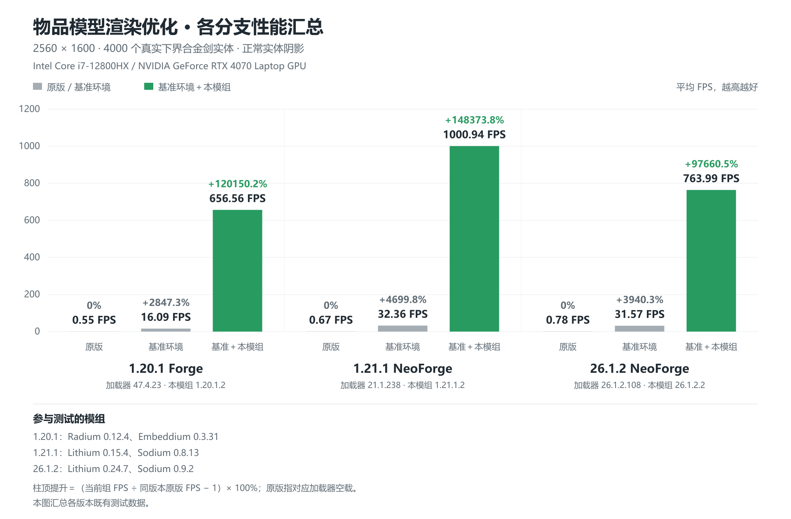

# 各分支平均帧与 low 帧优化复测

硬件为 Intel Core i7-12800HX / NVIDIA GeForce RTX 4070 Laptop GPU。

本轮分别对各分支的优化前代码与最终代码进行对照，均加载对应版本的基准环境和本模组，使用石质地面上的 4000 个真实下界合金剑实体、2560×1600 分辨率和正常实体阴影。每组分别测量原地静止和摄像机小幅水平移动，各 30 秒。1% low 按最慢 1% 帧的平均耗时换算为 FPS。最终渲染代码随各分支 `.3` 稳定版发布；版本标记更新不改变已测量的渲染逻辑。

| 分支 | 场景 | 平均 FPS：前 → 后 | 变化 | 1% low：前 → 后 | 变化 |
| --- | --- | ---: | ---: | ---: | ---: |
| 1.20.1 Forge | 静止 | 780.70 → 899.81 | +15.3% | 187.86 → 196.05 | +4.4% |
| 1.20.1 Forge | 视角移动 | 730.76 → 875.09 | +19.8% | 176.93 → 177.84 | +0.5% |
| 1.21.1 NeoForge | 静止 | 905.04 → 916.66 | +1.3% | 181.21 → 215.69 | +19.0% |
| 1.21.1 NeoForge | 视角移动 | 886.26 → 923.53 | +4.2% | 202.41 → 214.69 | +6.1% |
| 26.1.2 NeoForge | 静止 | 784.48 → 820.95 | +4.6% | 154.05 → 234.72 | +52.4% |
| 26.1.2 NeoForge | 视角移动 | 371.36 → 824.79 | +122.1% | 164.66 → 229.70 | +39.5% |

[SVG 图表](branding/low-frame-comparison.svg)

本表使用最终复测结果。1.20.1 本轮使用 Forge 47.4.22 / Java 17、Radium 0.12.4 与 Embeddium 0.3.31；1.21.1 使用 NeoForge 21.1.238 / Java 21、Lithium 0.15.4 与 Sodium 0.8.13；26.1.2 使用 NeoForge 26.1.2.108 / Java 25、Lithium 0.24.7 与 Sodium 0.9.2。每个版本内部前后保持相同配置。

保留的改动：静止场景跨 tick 复用，逐 tick 验证动画与物品状态；摄像机在不跨越物品渲染距离边界时复用记录，阴影距离衰减在 GPU 中计算；仅监听已参与批处理的物品栈变化；未改写的模型和阴影缓冲跳过内存比较。光照、区块变化、数量、组件和实体变化仍使相关场景失效。Forge 保留可变 NBT 的逐帧快照检查。

所有正式结果均保持 4000 个模型、7772 个阴影接收面实例，无失焦或 OpenGL 错误。三个版本均完成数量变化、附魔回退、位置变化、阴影开关、可见性开关、距离边界、缓存失效和实体移除检查。1.20.1 的移动 low 帧收益很小；真实实体 tick 等 CPU 工作仍然存在，不能把平均帧提升等同于 low 帧同比提升。

优化前的原版与基准环境历史对照

# 优化前历史测试汇总

统一场景为石质地面上的 **4000 个真实下界合金剑实体**，分辨率 **2560×1600**，正常实体阴影。硬件为 Intel Core i7-12800HX / NVIDIA GeForce RTX 4070 Laptop GPU。

[中文 SVG 矢量图](branding/branch-performance-summary.svg) · [English SVG](branding/branch-performance-summary-en.svg)

灰色表示原版与基准环境，绿色表示基准环境加入本模组。柱顶显示平均 FPS，以及相对**同一游戏版本原版组**的提升百分比。原版指对应 Forge / NeoForge 加载器空载。

| 游戏版本与加载器 | 测试组 | 平均 FPS | 相对原版提升 |
| --- | --- | ---: | ---: |
| 1.20.1 Forge | 原版（加载器空载） | 0.55 | 0% |
| 1.20.1 Forge | 基准环境 | 16.09 | +2847.35% |
| 1.20.1 Forge | 基准＋本模组 | 656.56 | +120150.22% |
| 1.21.1 NeoForge | 原版（加载器空载） | 0.67 | 0% |
| 1.21.1 NeoForge | 基准环境 | 32.36 | +4699.82% |
| 1.21.1 NeoForge | 基准＋本模组 | 1000.94 | +148373.80% |
| 26.1.2 NeoForge | 原版（加载器空载） | 0.78 | 0% |
| 26.1.2 NeoForge | 基准环境 | 31.57 | +3940.34% |
| 26.1.2 NeoForge | 基准＋本模组 | 763.99 | +97660.51% |

提升＝（当前组 FPS ÷ 同版本原版 FPS − 1）×100%，以未四舍五入的原始数据计算，再格式化显示。

## 参与测试的模组

| 游戏版本 | 原版组加载器 / Java | 基准组 | 基准＋本模组组 |
| --- | --- | --- | --- |
| 1.20.1 | Forge 47.4.23 / Java 17 | Radium 0.12.4＋git.26c9d8e；Embeddium 0.3.31＋mc1.20.1 | 相同基准＋本模组 1.20.1.2 |
| 1.21.1 | NeoForge 21.1.238 / Java 21 | Lithium 0.15.4＋mc1.21.1；Sodium 0.8.13＋mc1.21.1 | 相同基准＋本模组 1.21.1.2 |
| 26.1.2 | NeoForge 26.1.2.108 / Java 25 | Lithium 0.24.7；Sodium 0.9.2＋mc26.1.2 | 相同基准＋本模组 26.1.2.2 的渲染代码 |

26.1.2 使用修正材质背面剔除后的 **763.99 FPS**；测量时版本标记为 26.1.2.1，稳定版 26.1.2.2 使用相同渲染代码。

各版本分别测量，游戏资源、Java、加载器及优化模组版本不同。本图汇总本轮优化前记录，未在本轮重测原版和无 IMO 基准组；百分比反映这个物品密集场景，不代表常规游玩的普遍提升幅度。

本模组组均使用默认 GPU 动画与跳过可见性检查设置，全部保留 4000 个物品模型和 7772 个阴影接收面实例。跳过可见性检查指跳过遮挡与视锥判定，对渲染距离内、本模组接管的已加载普通掉落物全量提交，不使用 LOD。

此文件是唯一维护的最终测试报告，位于 `master`（1.21.1 NeoForge）分支。其他分支不再保留独立报告、旧图表或技术诊断文档。

